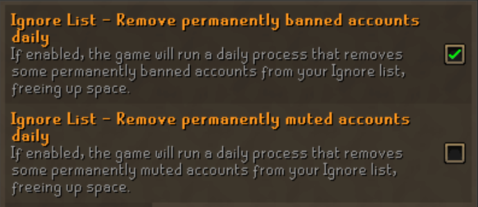

# Ignore List Ban Tracker 

A runelite plugin that tells you if reports you have made have led to permanent bans and mutes.

# Getting Started

Enable one or both of the settings in OSRS to start using the plugin

From here on, every time you log in, if any accounts have been automatically removed, you'll be treated to the following in the game chat:

`X users have been banned/muted from your ignore list since you were last logged in.`

So, simply report badly behaving users, and ensure you add them to your ignore list, and see the bans flow in!

# Testing

* Run plugin once with lastIgnoreListNames settings enabled and close the client
* Find your profile at `~/.runelite/profiles2/<profile>.properties`
* Edit `ignoreListBanTracker.rsprofile...lastIgnoreListSize=X` and increase the number
* Edit `ignoreListBanTracker.rsprofile...lastIgnoreListNames=X` and add some new comma separated entries
* Run the client and log in; check if the reported number matches the increase, and the added names are printed

# Image Sources

- Icon was obtained through ingame screenshots